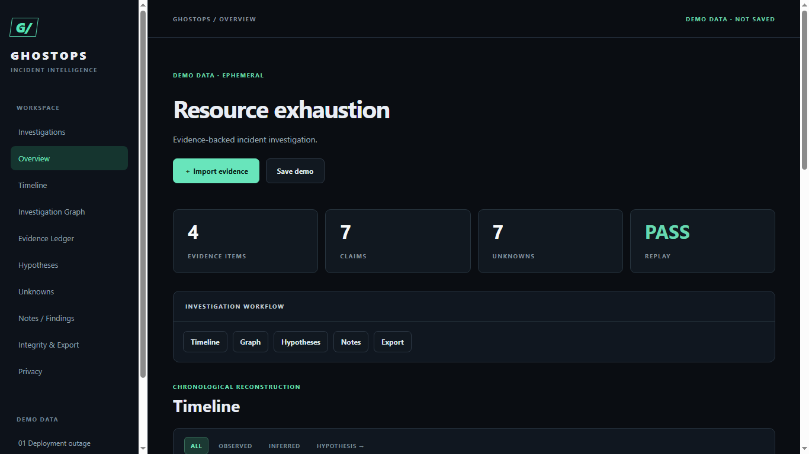
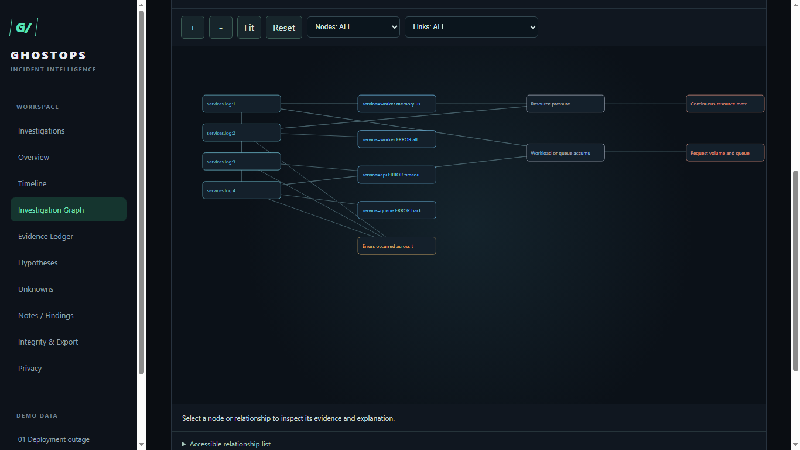

# GhostOps 1.0.0

GhostOps is a local-first workbench for reconstructing software incidents from exported evidence. It keeps original source text, builds a reproducible timeline, links claims to file locations, and separates observations, rule-based inferences, hypotheses, and unknowns. The project began from Kiro IDE specifications for Kiroween 2026; Codex implemented the application.

Incident reviews often mix facts, timing correlations, and plausible explanations in one narrative. GhostOps keeps those layers separate. An analyst can reopen the exact file record behind a claim, inspect competing explanations, and export a package that another browser can replay and check. It does not need an account, server, paid model, or live access to production systems.

**Live demo:** pending owner-authorized publication. All three built-in scenarios work locally without registration.





## Start

Node.js 20+ is required. In Windows PowerShell, from this directory:

```powershell
npm.cmd install
npm.cmd run dev
```

Open the local Vite URL. Create an investigation, give it a title, then import local files. Investigations and source files persist in IndexedDB for this browser profile and origin. Export a portable `.ghostops-investigation.json` package before clearing browser data or moving devices. A static production build is produced with `npm.cmd run build` and can be hosted without an application server.

For an evidence-first walkthrough, start with **Deployment outage**. Select a timeline event to inspect its source, then open the graph and compare hypotheses. For your own data, create an investigation and import exported files from the Investigations screen. See the [user guide](docs/user-guide.md).

## Supported inputs

- Plain UTF-8 text logs, one record per line, with ISO 8601 timestamps when present. Nginx, Docker, Node.js, and Python output is retained as generic text evidence; there are no dedicated parsers for those formats.
- JSON arrays/objects and JSONL CI records containing `step`, `status`, and optional `timestamp`; `dependency` and `version` enable the version-disagreement rule.
- JSON arrays/objects and JSONL deployment records containing `service`, `version`, `event`, and optional `timestamp`.
- Git text lines beginning with `commit ` plus a 40-character hex hash; JSON Git objects with `commit` and optional `timestamp`.

Other text and unfamiliar valid JSON objects are kept as generic log evidence, without a CI/deployment/Git label. GitHub Actions and GitLab CI live API connections are **not** implemented. See [supported formats](docs/supported-formats.md) for exact examples and limits.

## Working with an investigation

The sidebar opens Investigations, Overview, Timeline, Investigation Graph, Evidence Ledger, Hypotheses, Unknowns, Notes / Findings, Integrity & Export, and Privacy. Create, rename, duplicate, archive, reopen, and delete investigations. Deletion asks for confirmation. Source records, analyst notes, manual findings, and a local action history are kept separately. Graph nodes and edges open explanations and evidence; zoom, pan, fit, reset, filters, and a text relationship list are available. The three bundled incidents are labelled **DEMO DATA** and are not saved until you choose “Save demo.”

Export options are portable V2 JSON package, earlier V1 session JSON, and Markdown. Importing a package validates schema, source hashes, source offsets, local digest, and deterministic replay before saving it. The package hash is not a signature. See [integrity model](docs/integrity-model.md).

## What this tool does and does not do

GhostOps emits `OBSERVED` direct record claims, `INFERRED` correlations under rules R-01–R-07, and `HYPOTHESIS` explanations tied to evidence patterns. Root-cause claims require two corroborating source types, a causal diagnostic, and no blocking gap. Temporal proximity alone does not prove cause. The app makes no outbound requests during analysis. Findings depend entirely on imported records and can be incomplete or wrong if those records are incomplete or misleading. GhostOps does not autonomously determine the real cause of an incident or replace analyst judgment. Numeric claim scores required by the original Kiro contract are retained in the legacy model but are **not** shown as calibrated probabilities in the V2 UI.

The browser applies a Content Security Policy and renders imported text as text. Those controls do not establish absolute security or legal admissibility of evidence. Imported data is not executed. IndexedDB can be cleared by browser/profile changes; it is not server-grade durable storage.

## Architecture and performance

The ingestion, ledger, rule engine, claim verifier, timeline, graph, integrity checker, package format, persistence service, and UI are separate TypeScript modules. Local files are read in 1 MB chunks with progress and cancellation; saved-investigation import, reopen, integrity checks, and package operations run in a dedicated Web Worker. IndexedDB writes the investigation head and payload in one transaction. New package and payload hashes use key-sorted JSON; previously exported V2 packages remain readable. Rendering caps the graph, timeline, and unknowns to keep navigation usable. The browser accepts at most 20 files per import, 50 MB per source file, 100 MB of source text and 100,000 evidence records per investigation. Assembled text and Worker transfer still consume browser memory.

The synthetic Chrome E2E fixture contains 15,000 timestamped log records (993,889 UTF-8 bytes). The reproducible measurement and machine context are in [verification](docs/verification.md). This is a measured fixture, not a promise for every file or device. See [architecture](docs/architecture.md), [integrity model](docs/integrity-model.md), and [data persistence](docs/data-persistence.md).

## Kiro and Kiroween

The original requirements, design, tasks, and steering documents under `.kiro/` were created in Kiro IDE. Codex implemented the application, tests, and release documentation from that contract. Five Kiro hook configurations are valid against the published v1 schema and are reported as enabled in the owner's IDE; their actual IDE execution is still unverified. See [Kiro usage evidence](docs/kiro-usage-evidence.md) and the [Frankenstein submission draft](docs/kiroween-submission.md). No Kiro session logs have been invented.

## Static hosting

`render.yaml` prepares a Render Static Site with `npm ci && npm run build` and `dist` as the publish directory. `npm.cmd run e2e:production` tests the built app and Worker locally. No backend or user-data upload route is configured. Browser investigations belong to the exact site origin and browser profile; moving to a public domain requires package export/import. Hosting configuration is prepared, but this repository has not been published or deployed.

## Verification

See [1.0 release acceptance](docs/GHOSTOPS_1_0_RELEASE_ACCEPTANCE.md) for measured performance, remaining limits, and owner actions.

```powershell
npm.cmd run typecheck
npm.cmd run test:unit
npm.cmd run test:property
npm.cmd run test:integration
npm.cmd run coverage
npm.cmd run build
npm.cmd run e2e
npm.cmd run e2e:production
npm.cmd run secret-scan
npm.cmd run hooks:check
npm.cmd run benchmark
npm.cmd audit --audit-level=high
```

`e2e` uses a locally installed Google Chrome and the Chrome DevTools Protocol. The benchmark is synthetic and reports its environment in [verification](docs/verification.md). The npm audit endpoint was unavailable in the latest run, so dependency vulnerability status is not confirmed.

The original `.kiro/specs` and `.kiro/steering` files remain unchanged. V2 owner requirements are traced separately in [V2 requirements trace](docs/v2-requirements-trace.md); implementation status is in [feature matrix](docs/feature-matrix.md).
